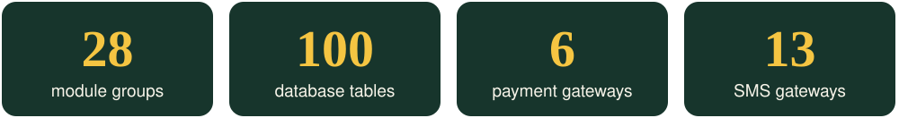
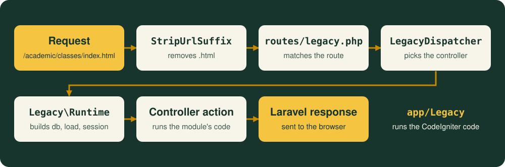

<a id="top"></a>

<p align="center">
  
</p>

<p align="center">
  
  
  
  
</p>

<p align="center">
  A multi-branch school management system with a public website for each branch.<br>
  Migrated from CodeIgniter (HMVC) to Laravel 10.
</p>

<p align="center">
  <a href="#modules"><b>Modules</b></a> &nbsp;·&nbsp;
  <a href="#requirements"><b>Requirements</b></a> &nbsp;·&nbsp;
  <a href="#installation"><b>Installation</b></a> &nbsp;·&nbsp;
  <a href="#architecture"><b>Architecture</b></a> &nbsp;·&nbsp;
  <a href="#development"><b>Development</b></a> &nbsp;·&nbsp;
  <a href="#tests"><b>Tests</b></a>
</p>

<p align="center">
  
</p>

<a id="modules"></a>

##  Modules

<table>
  <tr>
    <td width="33%" align="center" valign="top">
      <br>
      <b>Academics</b><br>
      <sub>Classes, sections, subjects, syllabus, materials, routines, live classes, promotion, assignments</sub>
    </td>
    <td width="33%" align="center" valign="top">
      <br>
      <b>People</b><br>
      <sub>Students, admissions, guardians, teachers, employees, designations</sub>
    </td>
    <td width="33%" align="center" valign="top">
      <br>
      <b>Attendance and leave</b><br>
      <sub>Student, teacher and employee attendance, absence notices, leave applications</sub>
    </td>
  </tr>
  <tr>
    <td align="center" valign="top">
      <br>
      <b>Exams</b><br>
      <sub>Schedules, marks, results, mark sheets, merit lists, result cards, grades, suggestions</sub>
    </td>
    <td align="center" valign="top">
      <br>
      <b>Finance</b><br>
      <sub>Invoices, fee types, discounts, payments, receipts, income, expenditure, payroll, reports</sub>
    </td>
    <td align="center" valign="top">
      <br>
      <b>Facilities</b><br>
      <sub>Library, hostel, transport</sub>
    </td>
  </tr>
  <tr>
    <td align="center" valign="top">
      <br>
      <b>Communication</b><br>
      <sub>Messages, email, SMS, notices, news, holidays, events, complaints</sub>
    </td>
    <td align="center" valign="top">
      <br>
      <b>Documents</b><br>
      <sub>ID cards, admit cards, certificates</sub>
    </td>
    <td align="center" valign="top">
      <br>
      <b>Front office</b><br>
      <sub>Visitors, call logs, postal dispatch and receive</sub>
    </td>
  </tr>
  <tr>
    <td align="center" valign="top">
      <br>
      <b>Administration</b><br>
      <sub>Schools and branches, roles and permissions, users, languages, themes, settings, backup, activity log</sub>
    </td>
    <td align="center" valign="top">
      <br>
      <b>Public website</b><br>
      <sub>Per-branch pages, online admission, gallery, contact form</sub>
    </td>
    <td align="center" valign="top">
      <br>
      <b>Integrations</b><br>
      <sub>Payment and SMS gateways, listed below</sub>
    </td>
  </tr>
</table>

**Payment gateways**

<kbd>DBBL</kbd> <kbd>PayPal</kbd> <kbd>PayUMoney</kbd> <kbd>CCAvenue</kbd> <kbd>Paytm</kbd> <kbd>Paystack</kbd>

**SMS gateways**

<kbd>Clickatell</kbd> <kbd>Twilio</kbd> <kbd>Bulk</kbd> <kbd>MSG91</kbd> <kbd>Plivo</kbd> <kbd>Textlocal</kbd> <kbd>SMSCountry</kbd> <kbd>BetaSMS</kbd> <kbd>BulkPK</kbd> <kbd>Cluster</kbd> <kbd>Alpha</kbd> <kbd>BDBulk</kbd> <kbd>MiMSMS</kbd>

<a id="requirements"></a>

##  Requirements

- **PHP** 8.3 or newer
- **Composer**
- **MySQL** or **MariaDB**
- **Apache** with `mod_rewrite` (for example WAMP), or `php artisan serve`

> [!NOTE]
> Node is not needed to run the application. No view uses Vite: the CSS and JavaScript are served directly from `public/assets`.

<a id="installation"></a>

##  Installation

<kbd>STEP 1</kbd> **Install the dependencies and create the environment file**

```bash
composer install
cp .env.example .env
php artisan key:generate
```

<kbd>STEP 2</kbd> **Configure the database**

Set the `DB_*` values in `.env`. The example file uses port `3307` and the database `smartinternation_school`.

<kbd>STEP 3</kbd> **Create the database and restore the data**

The dump is not in this repository, so get `smartinternation_school.sql` from a project maintainer and put it in the project root.

```bash
mysql -h 127.0.0.1 -P 3307 -u root -e "CREATE DATABASE smartinternation_school"
mysql -h 127.0.0.1 -P 3307 -u root smartinternation_school -e "source smartinternation_school.sql"
```

<kbd>STEP 4</kbd> **Run the migrations**

```bash
php artisan migrate
```

<kbd>STEP 5</kbd> **Open the application**

| Server | URL |
| --- | --- |
| WAMP | `http://localhost/ssm/public/` |
| `php artisan serve` | `http://localhost:8000` |

The login page is at `/auth/login.html`.

### Database notes

> [!WARNING]
> **Do not run `php artisan db:seed`.** `RolePermissionSeeder` expects the Spatie permission tables and a `users` table with `name` and `email` columns. Neither exists here. The application's roles and permissions are stored in its own tables and managed under `administrator/role` and `administrator/permission`.

- **With a dump:** the migration sees the existing tables and leaves them alone. Rolling it back does not drop them.
- **Without a dump:** `php artisan migrate` creates all the tables from `database/schema/application.sql`, but that file contains no data. There is no user to log in with, and `/` shows the purchase-code screen until a code is stored in the `purchase` table.

<a id="architecture"></a>

##  Architecture

The original controllers, models and views still run almost unchanged, on top of a compatibility layer in `app/Legacy`.

<p align="center">
  
</p>

| Path | Contents |
| --- | --- |
| `routes/legacy.php` | All application routes |
| `app/Legacy` | The CodeIgniter compatibility layer: base controller and model, loader, query builder, session, input, helpers |
| `app/Http/Controllers/<Module>` | Controllers, grouped by module |
| `app/Models/<Module>` | Models, grouped by module |
| `resources/views/<module>` | Plain PHP views, grouped by module |
| `app/Libraries` | Libraries loaded with `$this->load->library()` |
| `lang/english` | Language files |
| `public/assets` | CSS, JavaScript, images and uploaded files |
| `database/schema/application.sql` | The application's table definitions |

The `application` directory, if you have one locally, is the old CodeIgniter code. It is ignored by Git and is not used at runtime.

<a id="development"></a>

##  Development notes

### Adding a controller action

Routes are not discovered automatically. Add the method name to the controller's `Route::ci()` line in `routes/legacy.php`, or the URL returns a 404:

```php
Route::ci('academic/classes', \App\Http\Controllers\Academic\Classes::class, ['index', 'add', 'edit', 'name', 'delete'], 'academic', 'classes');
```

Extra URL segments are passed to the action as arguments, so `/academic/classes/edit/5` calls `edit('5')`.

### Route order matters

Custom routes come first, and `(:any)` matches any single-segment URL as a school's website.

| URL | Opens |
| --- | --- |
| `/dashboard` | The public website controller |
| `/dashboard/index` | The dashboard |

### Legacy behaviour to keep in mind

> [!CAUTION]
> - Routes in the `legacy` middleware group have no CSRF protection, because the old forms and AJAX calls do not send a token.
> - Passwords are stored as unsalted MD5 hashes, and login depends on that format.

- Notices and warnings are hidden during a legacy request, so an undefined index will not raise an error.
- Relative paths such as `./assets/uploads/` resolve against `public`, because `Runtime` changes the working directory there.

<a id="tests"></a>

##  Tests

```bash
php artisan test
```

`phpunit.xml` does not override the database, so the tests use the connection in `.env`.

---

<p align="center"><a href="#top"><b>Back to top</b></a></p>
