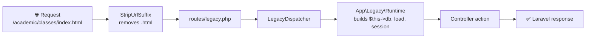

<div align="center">

# 🎓 Smart School

### One platform to run every branch of your school

A multi-branch school management system with a public website for each branch.<br>
Migrated from CodeIgniter (HMVC) to Laravel 10.

<br>


<br>

[**Modules**](#-modules) &nbsp;•&nbsp;
[**Requirements**](#-requirements) &nbsp;•&nbsp;
[**Installation**](#-installation) &nbsp;•&nbsp;
[**Architecture**](#-architecture) &nbsp;•&nbsp;
[**Development**](#-development-notes) &nbsp;•&nbsp;
[**Tests**](#-tests)

<br>

| 🧩 **28** | 🗃 **100** | 💳 **6** | 💬 **13** |
| :---: | :---: | :---: | :---: |
| Module groups | Database tables | Payment gateways | SMS gateways |

</div>

---

## ✨ Modules

| | Area | What it covers |
| :---: | --- | --- |
| 📚 | **Academics** | Classes, sections, subjects, syllabus, materials, routines, live classes, promotion, assignments |
| 👥 | **People** | Students, admissions, guardians, teachers, employees, designations |
| ✅ | **Attendance and leave** | Student, teacher and employee attendance, absence notices, leave applications |
| 📝 | **Exams** | Schedules, marks, results, mark sheets, merit lists, result cards, grades, suggestions |
| 💰 | **Finance** | Invoices, fee types, discounts, payments, receipts, income, expenditure, payroll, reports |
| 🏫 | **Facilities** | Library, hostel, transport |
| 📣 | **Communication** | Messages, email, SMS, notices, news, holidays, events, complaints |
| 🪪 | **Documents** | ID cards, admit cards, certificates |
| 🛎 | **Front office** | Visitors, call logs, postal dispatch and receive |
| ⚙ | **Administration** | Schools and branches, roles and permissions, users, languages, themes, settings, backup, activity log |
| 🌐 | **Public website** | Per-branch pages, online admission, gallery, contact form |

<details>
<summary><b>💳 Payment gateways</b></summary>
<br>

`DBBL` `PayPal` `PayUMoney` `CCAvenue` `Paytm` `Paystack`

</details>

<details>
<summary><b>💬 SMS gateways</b></summary>
<br>

`Clickatell` `Twilio` `Bulk` `MSG91` `Plivo` `Textlocal` `SMSCountry` `BetaSMS` `BulkPK` `Cluster` `Alpha` `BDBulk` `MiMSMS`

</details>

## 📋 Requirements

- **PHP** 8.3 or newer
- **Composer**
- **MySQL** or **MariaDB**
- **Apache** with `mod_rewrite` (for example WAMP), or `php artisan serve`

> [!NOTE]
> Node is not needed to run the application. No view uses Vite: the CSS and JavaScript are served directly from `public/assets`.

## 🚀 Installation

**1. Install the dependencies and create the environment file**

```bash
composer install
cp .env.example .env
php artisan key:generate
```

**2. Configure the database**

Set the `DB_*` values in `.env`. The example file uses port `3307` and the database `smartinternation_school`.

**3. Create the database and restore the data**

The dump is not in this repository, so get `smartinternation_school.sql` from a project maintainer and put it in the project root.

```bash
mysql -h 127.0.0.1 -P 3307 -u root -e "CREATE DATABASE smartinternation_school"
mysql -h 127.0.0.1 -P 3307 -u root smartinternation_school -e "source smartinternation_school.sql"
```

**4. Run the migrations**

```bash
php artisan migrate
```

**5. Open the application**

| Server | URL |
| --- | --- |
| WAMP | `http://localhost/ssm/public/` |
| `php artisan serve` | `http://localhost:8000` |

The login page is at `/auth/login.html`.

### 🗃 Database notes

> [!WARNING]
> **Do not run `php artisan db:seed`.** `RolePermissionSeeder` expects the Spatie permission tables and a `users` table with `name` and `email` columns. Neither exists here. The application's roles and permissions are stored in its own tables and managed under `administrator/role` and `administrator/permission`.

- **With a dump:** the migration sees the existing tables and leaves them alone. Rolling it back does not drop them.
- **Without a dump:** `php artisan migrate` creates all the tables from `database/schema/application.sql`, but that file contains no data. There is no user to log in with, and `/` shows the purchase-code screen until a code is stored in the `purchase` table.

## 🧱 Architecture

The original controllers, models and views still run almost unchanged, on top of a compatibility layer in `app/Legacy`.



| Path | Contents |
| --- | --- |
| 📄 `routes/legacy.php` | All application routes |
| 🔌 `app/Legacy` | The CodeIgniter compatibility layer: base controller and model, loader, query builder, session, input, helpers |
| 🎮 `app/Http/Controllers/<Module>` | Controllers, grouped by module |
| 🧬 `app/Models/<Module>` | Models, grouped by module |
| 🎨 `resources/views/<module>` | Plain PHP views, grouped by module |
| 📦 `app/Libraries` | Libraries loaded with `$this->load->library()` |
| 🌍 `lang/english` | Language files |
| 🖼 `public/assets` | CSS, JavaScript, images and uploaded files |
| 🗃 `database/schema/application.sql` | The application's table definitions |

The `application` directory, if you have one locally, is the old CodeIgniter code. It is ignored by Git and is not used at runtime.

## 💻 Development notes

### ➕ Adding a controller action

Routes are not discovered automatically. Add the method name to the controller's `Route::ci()` line in `routes/legacy.php`, or the URL returns a 404:

```php
Route::ci('academic/classes', \App\Http\Controllers\Academic\Classes::class, ['index', 'add', 'edit', 'name', 'delete'], 'academic', 'classes');
```

Extra URL segments are passed to the action as arguments, so `/academic/classes/edit/5` calls `edit('5')`.

### 🔀 Route order matters

Custom routes come first, and `(:any)` matches any single-segment URL as a school's website.

| URL | Opens |
| --- | --- |
| `/dashboard` | The public website controller |
| `/dashboard/index` | The dashboard |

### ⚠ Legacy behaviour to keep in mind

> [!CAUTION]
> - Routes in the `legacy` middleware group have no CSRF protection, because the old forms and AJAX calls do not send a token.
> - Passwords are stored as unsalted MD5 hashes, and login depends on that format.

- Notices and warnings are hidden during a legacy request, so an undefined index will not raise an error.
- Relative paths such as `./assets/uploads/` resolve against `public`, because `Runtime` changes the working directory there.

## 🧪 Tests

```bash
php artisan test
```

`phpunit.xml` does not override the database, so the tests use the connection in `.env`.

---

<div align="center">

Built with ❤ on [Laravel](https://laravel.com)

**[⬆ Back to top](#-smart-school)**

</div>
